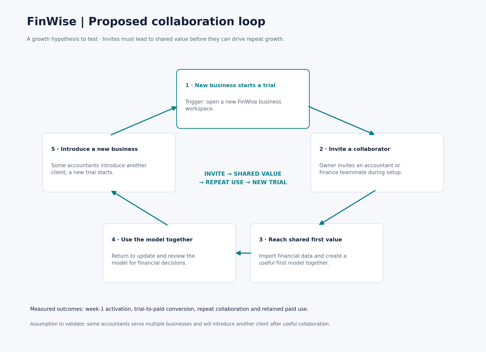

# The Bet · FinWise

> Module 1 · Ignite a PLG Motion. The growth hypothesis, strategic bet, and proposed growth loop.

## Growth hypothesis

FinWise's biggest growth problem is weak progression from trials to sustained paid use, because only 128 of 6,424 trial starts appear as paid conversions (1.99%), and the scenario reports just 40% one-year paid retention.

**Working notes:** My hunch is that trial users do not reach enough practical, repeatable value early enough to justify paying and staying. This is an explanation to test, not an established root cause.

**Evidence:**

1. Only about 2% of trial starters become paying customers.
2. Only 40% of paid customers remain after one year; 60% churn.
3. Most marketing spending goes to paid acquisition, but adding more acquisition spending no longer drives meaningful growth.

**Against the data:** The dataset shows 128 paid conversions from 6,424 trial starts, with monthly trial-to-paid ratios staying near 2%. This supports prioritizing progression from trial to paid use. It does not establish that onboarding or collaboration is the root cause.

---

## The bet

The first experiment I would run is an optional invite-an-accountant-or-teammate step during trial onboarding. A relevant collaborator may help a small-business owner import financial data, create a first useful model, and apply the output to a real business workflow.

I would measure whether this increases week-1 activation, defined as a trial workspace importing financial data and creating at least one model within seven days. Day-1 drop-off would be the guardrail. Trial-to-paid conversion and retained paid use would be downstream outcomes to monitor.

**Not doing:** I am not increasing paid acquisition spending or prioritizing broad content and referral campaigns first, because those efforts would pull focus from testing whether existing trial accounts can reach useful shared value and convert.

---

## Growth loop

**Loop type:** Collaboration.

**Rationale:** A small-business owner and an accountant or teammate may reach useful financial outcomes together. If shared value creates repeat use, some collaborators may introduce another business to FinWise, connecting activation and engagement to distribution.

**Proposed loop:** A new business starts a trial, invites a finance collaborator, reaches shared first value, and returns to use the model. Some collaborators introduce another business, creating a new trial and restarting the loop.

Cross-business introductions are an assumption to validate, not an observed result.

