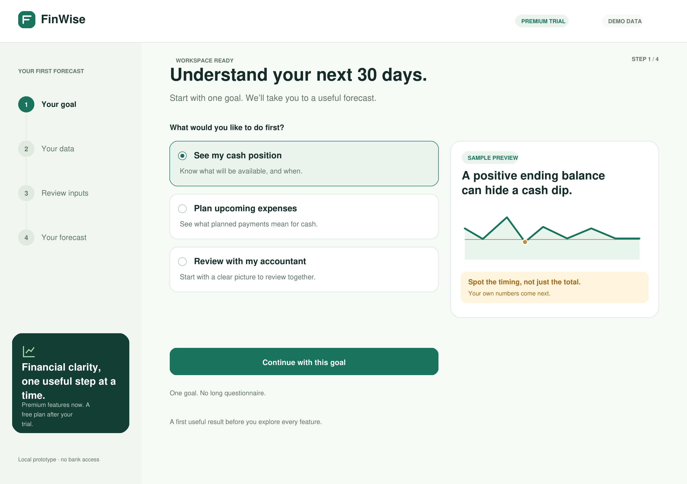
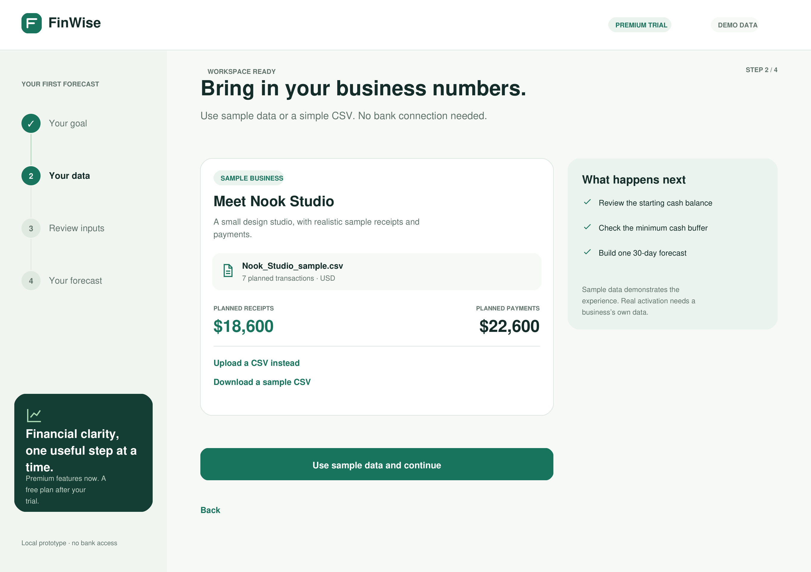
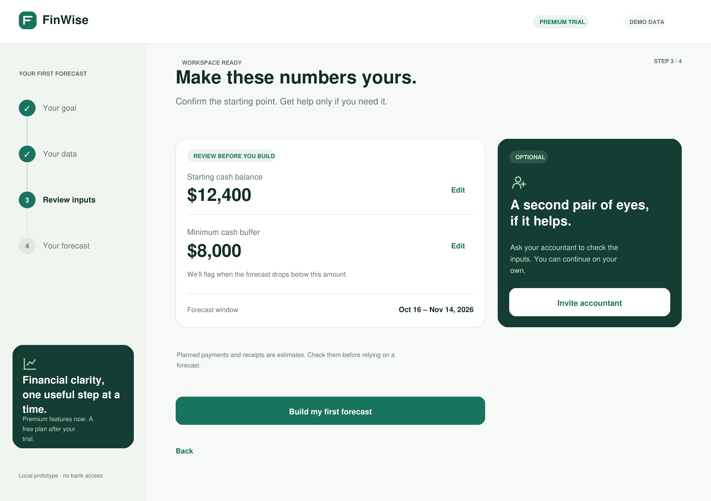
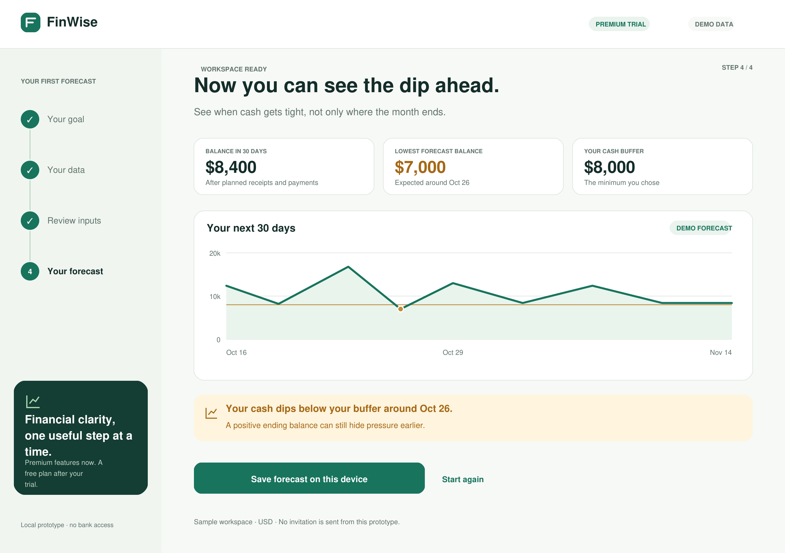

# The Solution · FinWise

> Module 2 · Acquisition & Activation. A four-screen onboarding prototype, submitted as screen images.

## Aha moment

**“I can see when my business may run short of cash before it happens, even if the ending balance looks healthy.”**

The proposed moment occurs when a small-business owner creates a first 30-day cash-flow forecast from their business data and understands its lowest cash point relative to a buffer they chose. The prototype illustrates this with fictional Nook Studio data: starting cash of $12,400, planned receipts of $18,600, planned payments of $22,600, an ending balance of $8,400, and a low point of $7,000 on October 26, below an $8,000 buffer.

This is a candidate Aha moment. The scenario’s 2% trial-to-paid conversion and 40% one-year paid retention motivate investigating early value, but do not establish this specific cause, moment, or retention relationship.

## Onboarding prototype

**Submission format:** Four screen images. The flow begins immediately after sign-up, with the workspace ready.

| Screen | Single job | Primary action |
| --- | --- | --- |
| 1. Your goal | Choose the immediate outcome and see a labelled value preview | Continue with this goal |
| 2. Your data | Bring in the inputs with a low-friction CSV or sample-data path | Use the selected data and continue |
| 3. Review inputs | Confirm the starting balance and cash buffer; optionally ask an accountant to review | Build my first forecast |
| 4. Your forecast | Understand the cash low point and its timing | Save the forecast |

The optional accountant invitation sits inside the review step, before first model creation, so the Module 1 collaboration bet can still be tested against week-1 activation. Continuing never requires an invitation or waiting for another person.

### Screen 1 · Your goal

### Screen 2 · Your data

### Screen 3 · Review inputs and optional collaboration

### Screen 4 · First forecast and candidate Aha moment

**Clickable version:** Download [finwise-onboarding.html](finwise-onboarding.html) and open it in a browser. It runs locally and includes next/back navigation, goal-specific result copy, editable starting cash and buffer, a local sample CSV import, an invitation-preview dialog, and saving the forecast on the current device. The invitation is a simulation and sends no message.

## Why this activates

The flow brings an owner to one concrete financial insight with one goal question, a short data step, and pre-filled editable inputs, rather than requiring broad configuration before first value. An optional accountant invitation supports the Module 1 hypothesis that a relevant collaborator may help the owner validate inputs and create a useful first model, while allowing independent completion. I expect understanding the timing of a cash dip to give the owner a reason to update the forecast repeatedly; this remains a hypothesis to validate, not a demonstrated conversion or retention gain.

**Friction avoided in the proposed design:** a long profile questionnaire, a required bank connection, and mandatory collaborator invitations. These are deliberate prototype choices, not claims that we observed those exact blockers in FinWise’s current onboarding.

**Primary metric for a future account-level experiment:** Week-1 activation — the percentage of assigned trial workspaces importing their own business data and creating at least one financial model within seven days, consistent with Module 1.

**Guardrail:** Day-1 onboarding abandonment — the percentage of trial workspaces starting onboarding but not completing the core data-to-first-model path within 24 hours. Agree and instrument this operational definition before testing.

**Downstream checks:** Trial-to-paid conversion and continued useful use. Investigate whether the early behavior predicts weekly return and 90-day retention using account-level cohorts with equal observation windows.

**Prototype limit:** Sample data demonstrates the experience; a sample-only run does not count as production activation. No live customer experiment has been run, and no lift is claimed.
