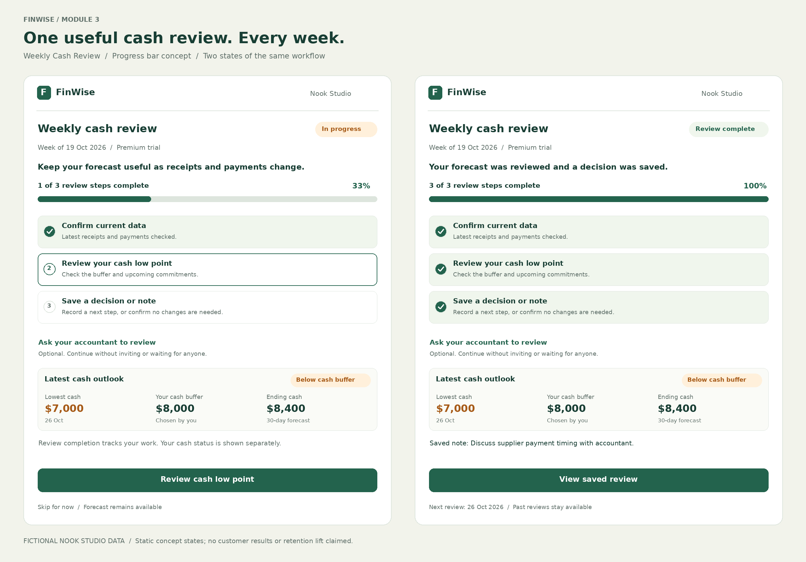

# The Mechanic · FinWise

> Module 3 · Engagement & Retention. Proposed mechanic: a Weekly Cash Review progress bar. This is a design hypothesis, not a validated retention result.

## The mechanic

**Chosen mechanic:** Progress Bar — Weekly Cash Review.

**Connection to Module 2:** The candidate Aha moment is understanding when the business's cash may fall below its chosen buffer, even when its ending balance looks healthy. The proposed activation signal remains importing the business's own data and creating a first financial model within seven days. This mechanic supports repeated useful use after that first model; it does not redefine activation.

**Behavior to repeat:** Update or confirm the business's cash-flow inputs, review the next 30 days and the lowest cash point against its buffer, and save one decision or an explicit “no changes needed” note. This is a candidate retention-related behavior whose predictive relationship still needs account-level validation.

**Natural cadence:** Weekly, as an initial assumption for owners who review upcoming receipts and payments weekly. Confirm this cadence with actual users; it is not appropriate for every business.

**What losing progress would feel like:** Missing a review may mean relying on older inputs or overlooking changed assumptions. There is no evidence that breaking a streak itself would feel meaningful. Past forecasts and review history remain available, with no penalty or erased progress.

**What the user sees:** A three-step checklist with a visible progress bar on the cash-review page:

1. Confirm that the business data is current. Refresh or edit when needed; allow a meaningful confirmation when nothing changed.
2. Review the lowest cash point, the chosen buffer, and upcoming payments.
3. Save a decision, follow-up note, or “no changes needed.”

Progress follows these review steps, not screen opens or arbitrary points. The existing forecast stays accessible throughout. A new weekly review starts a new checklist while preserving previous reviews. Completing the review means the information was reviewed; it does not mean that cash is healthy or above the buffer.

### Habit loop

- **Trigger:** The owner's chosen weekly planning moment, supported by an optional reminder when the next review is due. Reminders can be turned off.
- **Action:** Complete the meaningful three-step cash review using the business's own data.
- **Reward:** See a completed review and an up-to-date cash outlook, including the cash low point and any change from the previous review when comparable data exists. The practical reward is clarity; details vary with real business data, not invented surprises.
- **Investment:** Save current inputs, the cash buffer, a dated review note, and optionally a comment from an accountant. This preserves useful context for the next review. Collaboration remains optional and never blocks completion.

## Rationale

**Working churn diagnosis:** I would investigate insufficient repeatable value after the first forecast as a possible contributor to churn. The scenario's approximately 2% trial-to-paid conversion and 40% one-year paid retention justify investigating this, but do not establish the cause. Price-related churn is unresolved because no pricing, willingness-to-pay, cancellation-reason, or customer-level cohort evidence was provided.

**What the table shows:** Average session duration is 14.26 minutes in March 2024 and 7.93 minutes in September, while the reported Modeling metric moves from 40.35% to 58.06%. In October, session duration is 8.95 minutes and Modeling is 36.04%. Shorter sessions therefore cannot simply be labelled less valuable, and these figures do not demonstrate a consistent improvement in repeated modeling. The Modeling metric's denominator and definition also need clarification. Monthly aggregates do not establish whether the accounts using models are the accounts that retain. The “Churned (1yr)” column should not be divided by the same row's new paid conversions without cohort definitions.

**Why this mechanic fits:** A cash review has a clear completion state, so a progress bar can make useful work feel manageable and visibly complete. It addresses the proposed repeat-value problem by helping an owner keep a financial forecast relevant to current decisions. It can be experienced during a trial when the review cadence allows, rather than appearing only after payment. It is not evidence that a user about to churn would stay.

**Why someone might return:** A refreshed forecast and saved review context may help the owner answer the same practical question as their business changes: “Will cash cover the upcoming commitments?” If useful recurrence is missing, a clearer review routine may help. If the underlying problem is inaccurate output, unaffordable pricing, or poor product fit, the progress bar will not solve it; the bet would need to change.

**Deliberately not choosing:** I ruled out a daily streak because the proposed behavior is weekly and losing a counter has no demonstrated value to these users. I also ruled out a leaderboard because outperforming other businesses is unrelated to understanding one's own cash position. The chosen motivation is visible progress toward a useful completed review.

**Main design risk:** Users could tick boxes for completion without gaining useful insight. Tie progress to the review workflow, allow “no changes needed,” and avoid rewards for empty visits. Do not imply that 100% completion means a financially healthy business.

**How I would validate it:** At the workspace level, compare the same cash-review functionality with versus without the progress bar and milestone framing. Keep access to insights, task functionality, collaboration options, and reminder policy comparable. Enroll workspaces after the first own-data forecast and analyse assigned groups.

- **Primary engagement metric:** Week-2 meaningful review rate — the percentage of assigned workspaces completing the defined review during days 8–14 after their first own-data forecast, with an equal 14-day observation window. Count eligible workspaces regardless of whether they converted during that window. This is a behavioral proxy, not proof of felt value.
- **Downstream checks:** Week-4 meaningful use, trial-to-paid conversion, and longer-term paid retention, with appropriate cohort windows. Confirm the actual reverse-trial length before interpreting exposure before and after the paywall; no trial duration is assumed here.
- **Guardrails:** Review abandonment and optional-reminder opt-out rates. Define comparable denominators before launch.

No experiment has been run and no engagement, conversion, or retention lift is claimed.

## Wireframe

**Submission:** A standalone two-state wireframe image, sufficient for this lab without integration into the Module 2 prototype.

The left state shows an unfinished review with a clear next action; the right shows a saved review and the next review date. Both show the same below-buffer cash outlook, so completion is not confused with financial health. The figures are the same fictional Nook Studio example used in Module 2: $12,400 starting cash, $18,600 receipts, $22,600 payments, $8,400 ending cash, a $7,000 low point on October 26, and an $8,000 chosen buffer. This is a static concept, not a screenshot of a running product or live customer data.

Place this image beside this file in `03-mechanic` so its relative Markdown link renders in the repository.
