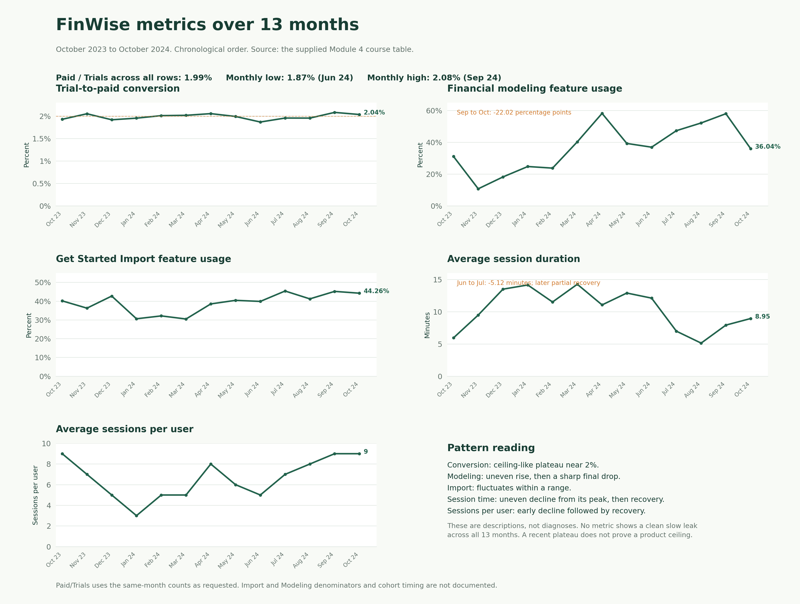
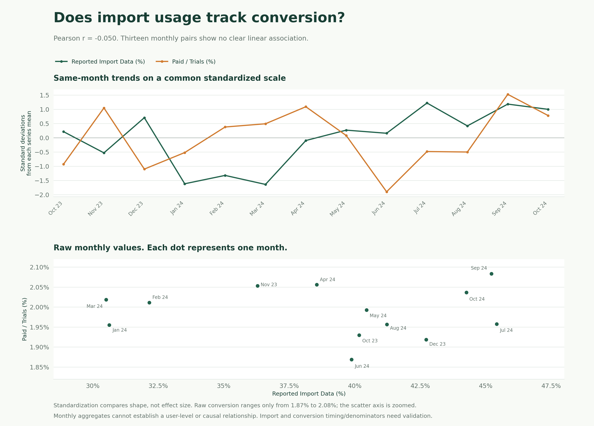

# The Signals · FinWise

> Module 4 · Data literacy and metrics. Source: the 13-month course table supplied in the lab, October 2023 to October 2024. Computations use full precision before display rounding.

## The data pattern

**M1 hypothesis carried forward:** FinWise's biggest growth problem is weak progression from trial to sustained paid use. My working explanation is that users may not reach enough useful, repeatable value early enough. This is a hypothesis, not an established root cause.

**Largest observed relative drop-off: Revenue.** The supplied rows total 94,558 visits, 6,424 trials, and 128 paid conversions. Trials to paid is 128 / 6,424 = **1.99%**, so 98.01% of trial starts do not appear as paid conversions in these table totals. Acquisition has a larger absolute loss, but the trial-to-paid transition has the larger proportional loss. The table does not show enough linked activation events to locate the exact cause inside the trial experience.

### Dashboard and pattern classifications

| Metric | Pattern classification | Specific observation |
| --- | --- | --- |
| Trial-to-Paid Conversion Rate | **Ceiling-like plateau**, rather than a fully demonstrated ceiling | The monthly Paid / Trials ratio stays between **1.87% and 2.08%**, close to 2% throughout. The approach to a ceiling is not observed, and these data do not establish a product limit. |
| Financial Modeling Feature Usage % | **No clean overall category; a local cliff-like final drop** | The series rises unevenly from 31.17% in Oct 2023, peaks at 58.26% in Apr 2024, reaches 58.06% in Sep, then falls to 36.04% in Oct: **-22.02 percentage points**. One final point does not establish a lasting regime change. |
| Get Started Import Feature Usage % | **Range-bound fluctuations; no clean Cliff, Slow Leak, or Ceiling** | It varies from **30.51% to 45.42%**, with a Jan–Mar trough followed by recovery. There is no consistent full-period decline. |
| Average Session Duration | **Uneven decline from a peak, then partial recovery; not a clean Slow Leak** | It rises from 5.95 minutes to 14.26 in Mar, then fluctuates downward to 5.14 in Aug before recovering to 8.95 in Oct. Jun–Jul contains a sharp local drop from 12.11 to 6.99 minutes. Duration alone does not measure value. |
| Average Sessions Per User | **Early decline followed by recovery; no clean overall category** | It falls from 9 in Oct 2023 to 3 in Jan 2024, then recovers to 9 in Sep and Oct. Two final equal observations are insufficient to establish a durable ceiling. |

### Correlation check and hypothesis update

**Selected indicator:** Leading 1, using the supplied **Import Data (%)** column as an imperfect monthly proxy for own-data import completion. The exercise's precise cohort-level rate is not available.

Pearson correlation between the 13 reported Import Data percentages and the 13 same-month Paid / Trials ratios is **r = -0.0495**, approximately **-0.05**. This shows no clear linear association in these monthly aggregates. Spearman rank correlation is 0.00 as a supplementary check. This is descriptive analysis, not a significance or causality claim.

The time overlay standardizes each series as (value - series mean) / sample standard deviation to compare shapes on one axis. It does not change the raw calculations or make the narrow conversion range economically large. The scatter uses raw values and a clearly zoomed conversion axis.

**Exercise response: Revised the hypothesis.** The headline is 2% trial-to-paid conversion. The deeper observed pattern is that conversion remains near 2% while reported import and modeling usage fluctuate. The data do not confirm that increasing the reported import percentage alone will improve payment conversion. I would revise my explanation to investigate what happens between an imported dataset, a genuinely useful first output, repeated useful use, and the payment decision. Importing data remains a necessary step in the course-defined value path, but is not a validated predictor of payment here.

This does not prove that onboarding or import improvements are ineffective. It does not establish pricing, collaboration, or lack of value as the cause. Investigate the Sep–Oct modeling change by cohort, measurement definition, release history, and data quality before designing a fix. Do not infer a product ceiling solely from a flat conversion series.

### Limits that affect the decision

- These are 13 monthly aggregates, not linked users or workspaces. Same-month association cannot establish user-level prediction, causal effect, or delayed effects.
- The table does not document whether each month's Paid count belongs to that month's trial-start cohort. Paid / Trials is used as the requested course-table ratio, pending a cohort-aligned definition.
- Import and Modeling percentages lack denominators, timing windows, and a joint event count. Do not multiply them to invent the North Star or divide them to infer import-to-model conversion.
- Monthly Paid counts are small, from 6 to 13, and all 13 are numerically consistent with rounding 2% of Trials to a whole customer. Verify data construction before interpreting tiny rate differences as a business change.
- The Churned (1yr) cohort is unspecified. Do not divide that column by same-row new Paid or use it to recalculate annual retention. The scenario's 40% paid retention remains a separate given.
- Revenue equals Paid × 78,125 in every supplied row. It is not an independent corroborating signal here, and summing it does not establish ARR.

## Leading indicators

### Aim · Move · Prove

The course fixes the North Star for this exercise. The 7-day window below is a proposed operational definition consistent with M1–M2, not a definition supplied by the monthly columns. Report both the North Star count and its trial-cohort rate so acquisition volume is visible.

| Layer | Metric | Why |
| --- | --- | --- |
| **Aim · North Star** | **The number of trial users who import financial data and reach their first modeling output.** Operational proposal: unique trial users completing both with their own business data within 7 days of trial start. | This is the course-defined first-value behavior and preserves the activation path from M1–M2. It is a measurable value proxy, not proof that each user experienced an Aha moment. |
| **Move · Leading 1** | Own-data import completion rate by trial day 7: unique trial users completing a successful import / unique trial starters in the same cohort. | Import is an upstream prerequisite for the North Star. Reducing a verified import obstacle could help more users reach a useful output before deciding whether to pay. The provided Import Data (%) series is only an exploratory proxy. |
| **Move · Leading 2** | First-model completion among importers by trial day 7: unique users completing their first valid output / unique users who successfully imported, within the same trial-start cohort and observation window. | This tests the next link from data to output rather than rewarding import alone. It may reveal where the pre-payment experience stops progressing. This conditional rate cannot be computed from the supplied Modeling (%) column. |
| **Prove · Lagging** | Cohort-aligned trial-to-paid conversion rate, observed through the trial end plus an agreed payment window. | A higher first-value count should eventually translate into more paid customers if this growth bet works commercially. Track subsequent paid retention as well before claiming sustainable growth. |

**Connection to M1:** The observed drop is at Revenue, while these candidate leading indicators investigate upstream activation steps that may contribute to it. They are hypotheses about the route to payment, not a relocation of the measured drop-off.

The M3 weekly cash review remains a candidate engagement/retention signal after first output. Its completion events are absent from this table, so this exercise cannot test that mechanic or its retention effect.

**First experiment to prioritise:** After verifying event definitions and identifying the actual obstacle, test a focused improvement in the own-data-to-first-model path, including the optional accountant-review bet from M1 where relevant. Measure import completion and model completion, then payment conversion. Do not claim a specific interface change is the cause or solution based on these aggregates.

## Lagging indicators

**Primary commercial result:** Trial-to-paid conversion by trial-start cohort. The available table proxy is Paid / Trials × 100. Its weighted aggregate is **1.9925%**; the simple mean of monthly ratios is **1.9877%**. These are different calculations even though both display as 1.99% to two decimals.

**Sustainability check:** Paid retention at defined follow-up points, including the scenario's one-year horizon. A short-term conversion increase alone does not demonstrate durable revenue growth. Revenue expansion and recurring revenue can be monitored once their definitions and cohort relationships are available.

**Data needed to prove the bet:** Linked trial-start, successful own-data import, first valid model, useful weekly review, payment, cancellation, and subscription events. Keep user-level North Star events distinct from the paying business account, map users to workspaces, and use workspace-level assignment for collaboration experiments. Use comparable cohorts and equal observation windows.

**Success is not established by correlation alone.** Validate the candidate leading indicators on account-level cohorts and test an intervention with a suitable comparison. No customer experiment or lift is claimed in this deliverable.

**Files:** Keep this file, `finwise-metrics-dashboard.png`, `import-vs-conversion.png`, and `finwise-monthly-data.json` together in `04-signals`. The JSON preserves the supplied values and calculated ratios. Method reference: [SciPy Pearson correlation documentation](https://docs.scipy.org/doc/scipy/reference/generated/scipy.stats.pearsonr.html).
